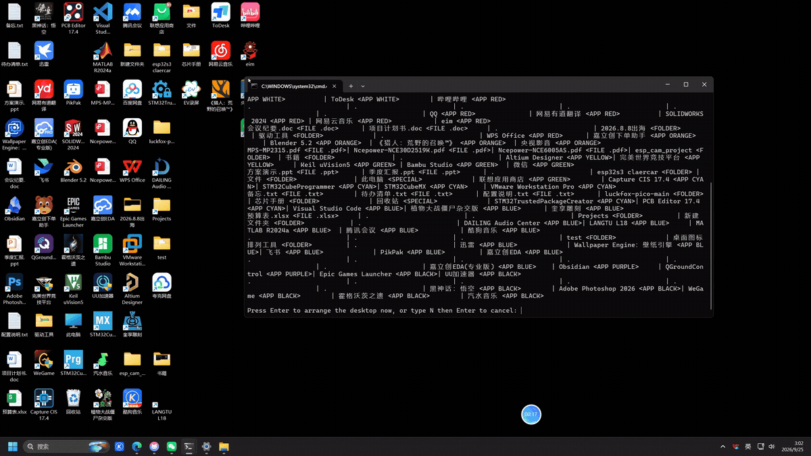

# 桌面图标排列工具 · Desktop Icon Arranger

一个绿色免安装的 Windows 小工具：**按图标自身的颜色自动分类**，把桌面排成四个区域；
排列前自动备份，排错了按一下就退回原样。

> A portable Windows tool that classifies desktop icons **by their dominant colour** and lays
> them out in four zones — loose files by type, folders, This PC / Recycle Bin, and applications
> as a colour band. Single console entry, multi-monitor aware, one-click undo.
> No installer, no admin rights, no network access.



*（演示动图是旧版多入口界面，分区与配色逻辑与现版一致）*

---

## 特性

- 🎨 **按主色分类（面积投票 + 中位色）** —— 统计各色系占的像素面积，取“最醒目”的那一类；
  面积压不倒时用**中位色**定案，再分不出来就进「杂色」区
- 🗂️ **四区布局** —— 临时文件（按扩展名分行）· 文件夹（居中块）· 此电脑+回收站（单列）· 应用软件（颜色带）
- 🌈 **颜色带** —— 白 → 红 → 橙 → 黄 → 绿 → 青 → 蓝 → 紫 → 黑；色系内按色相衔接，每行内再按「鲜明度」左亮右暗排
- 📐 **紧凑拼行（默认）** —— 一行尽量一个色系；只有当小色系拼一下能少占一行时才拼，行数最少、上下留白
- 🖥️ **多显示器** —— 自动枚举每块屏幕；单屏直接排，多屏先问排到哪一块。每块屏按自己的 DPI 算网格、单独实测锚点
- ↩️ **一键撤销** —— 每次排列/应用/恢复前自动快照，可以连续撤销；另有「最初布局」兜底
- ✍️ **人机协作** —— 自动排 → 手工微调 → 保存为「我的布局」→ 一键回放
- 🛠️ **分类覆盖表** —— 用一个文本文件覆盖算法的判断（`图标名 = 颜色系 / 区域`），写错也不会崩
- 🖼️ **效果图预览** —— 一条命令生成「现在 / 紧凑拼行 / 严格分行」三联图，不动真实图标
- 🧩 **零依赖** —— 只用 Windows 自带的 PowerShell 5.1 与 .NET Framework，不联网、不装东西

## 快速开始

1. 下载或克隆本仓库（整个文件夹一起拿，别只拷单个 `.ps1`）
2. 桌面右键 → 查看 → **关闭「自动排列图标」**（「对齐到网格」保持开启即可）
3. 双击 `桌面图标工具.cmd`

菜单：

| 选项 | 作用 |
| --- | --- |
| `1` 自动排列桌面 | 先打印方案，回车确认；多屏时会先让你选目标屏幕；排完自动校验 |
| `2` 保存当前布局 | 存成 `snapshots/my-<电脑名>.json` |
| `3` 应用「我的布局」 | 一键回到保存的那份布局 |
| `4` 撤销上一次操作 | 回到操作前的图标位置，可连续撤销 |
| `5` 恢复到「最初布局」 | 第一次排列时自动生成的那份 |
| `6` 查看显示器与图标分布 | 每块屏的分辨率、DPI、网格、图标数 |

> 完整中文说明（分区规则、微调须知、参数含义、配色阈值）见 [`使用说明.txt`](使用说明.txt)

## 命令行用法（进阶）

```bat
powershell -ExecutionPolicy Bypass -File DesktopIconTool.ps1 -Action Info
powershell -ExecutionPolicy Bypass -File DesktopIconTool.ps1 -Action Preview -Monitor 1
powershell -ExecutionPolicy Bypass -File DesktopIconTool.ps1 -Action Arrange -Monitor 1 -Yes
powershell -ExecutionPolicy Bypass -File DesktopIconTool.ps1 -Action Undo
powershell -ExecutionPolicy Bypass -File DesktopIconTool.ps1 -Action Render -Out D:\对比图.png
```

`-Action`：`Menu`（默认）· `Info` · `Check` · `Preview` · `Arrange` · `Save` · `Apply` · `Undo` · `Original` · `Render`

`-Strategy`：

| 值 | 排法 |
| --- | --- |
| `Compact`（默认） | 一行尽量一个色系；小色系/孤色系拼进邻行的空位，行数最少 |
| `Strict` | 严格一行一个色系，换色系就换行（行数最多，颜色带最纯） |
| `Packed` | 整条颜色带逐行填满，行尾直接接下一个色系（右边不留缺口） |

## 工作原理

1. **找到图标容器**
   桌面图标住在 explorer.exe 的标准列表控件里：`Progman`（或某个 `WorkerW`）
   → `SHELLDLL_DefView` → `SysListView32`。

2. **跨进程读写**
   `OpenProcess` 拿 explorer 句柄，`VirtualAllocEx` 在对方进程里申请一块「信箱」；
   用 `LVM_GETITEMTEXTW` 读名称、`LVM_GETITEMPOSITION` 读坐标，写回用 `LVM_SETITEMPOSITION`。
   启动即调用 `SetProcessDpiAwarenessContext(-4)`（per-monitor v2），否则 150%/200% 缩放下
   坐标会被虚拟化，格子数量直接算错。

3. **每块屏幕各自的网格**
   `LVM_GETITEMSPACING` 只返回主屏的格子（本机 150×198），副屏若 DPI 不同就完全对不上。
   所以用 `GetDpiForMonitor` 按 DPI 比例算出各屏的格子（96 DPI 副屏 = 75×99），
   锚点也分屏实测；某块屏当前没有图标时，会用一个探针图标短暂挪过去量一下再还原。

4. **取颜色**
   `SHGetFileInfo(SHGFI_ICON | SHGFI_LARGEICON)` 拿到图标真实位图，逐像素统计两套东西：
   - **各色系占的面积**（白/黑/灰/红/橙/黄/绿/青/蓝/紫 十个桶）
   - **中位色**（每个通道取中位数，对“一片背景 + 一个小 logo”特别稳）

5. **分类（v2：面积投票 + 中位色）**
   近白面积 ≥ 50% 或中位亮度 ≥ 0.85 → 白；近黑面积 ≥ 50% → 黑；某色系占面积 ≥ 40% 时让它说话
   （暖色直接用，冷色但中位亮度 ≤ 0.20 归黑）；否则用中位色色相定案；实在读不出 → 杂色 `MIXED`。
   阈值全在 `DesktopIconTool.ps1` 顶部（`$whiteAreaCut` / `$dominantCut` / `$nearGraySat` …），可直接改。

6. **落位（这里有个坑）**
   桌面列表控件是 `LVS_OWNERDATA`，而且 explorer 的行为是：**把图标移动到已被占用的格子，
   会把原占用者挤开并连锁扩散**。所以采用三阶段：

   ```
   ① 暂存：先搬到空闲列，让所有目标格变空
   ② 落位：再逐个填进目标格（此时不会触发挤开）
   ③ 校验：重新读取全桌名称+坐标与计划比对，有偏差就修补，直到 0 偏差
   ```

## 与旧版 / 其他项目的区别

「读写图标坐标 / 保存还原布局 / 网格排列」已有不少开源实现
（[desktop-icon-mcp](https://github.com/ei-grad/desktop-icon-mcp)、
[desktop-icon-backup-manager](https://github.com/mapi68/desktop-icon-backup-manager)、
[Positioner](https://github.com/s0d3s/Positioner) 等）。本项目额外做的是：

- **按图标自身主色分类**，并给出「一行一个色系」的渐变带
- **规则化分区**：文件按类型分行 / 文件夹居中块 / 系统图标单列 / 应用区颜色带 / 区域防撞
- **紧凑拼行**：在“色系纯”和“少占行”之间找平衡
- **分类覆盖表**：让个人审美覆盖算法判断
- **多屏 + 每屏 DPI** 的网格与锚点处理
- **快照/撤销栈**：每次操作前自动备份，随时退回
- **对比图渲染**：不改桌面就能先看三种排法

## 目录

```
DesktopIconTool.ps1   主程序（交互菜单 + 全部功能）
IconColor.cs          图标取色与分类（C#，运行时编译）
Native.cs             Win32 P/Invoke
桌面图标工具.cmd        双击入口
使用说明.txt           完整中文说明
分类覆盖.txt           个人分类覆盖表
snapshots/            运行时生成：快照、历史栈、我的布局、预览图（已 gitignore）
```

## 环境要求

- Windows 10 / 11
- Windows PowerShell 5.1 与 .NET Framework 4.x（系统自带）
- explorer.exe 在**当前登录用户**的桌面会话中运行
- 桌面已关闭「自动排列图标」

## 已知限制

- 排列会把全部图标集中到所选的那一块屏幕上（不会跨屏分散）
- 图标多到应用区会撞上文件夹区时，脚本直接报错退出，绝不乱排
- 需要读写 explorer 进程内存，首次运行可能被 SmartScreen 或杀毒软件拦一次，允许即可；
  它不修改任何文件、不改系统设置
- `snapshots/` 是本机私有状态（含电脑名与图标清单），已在 `.gitignore` 中排除

## 许可

[MIT](LICENSE)
